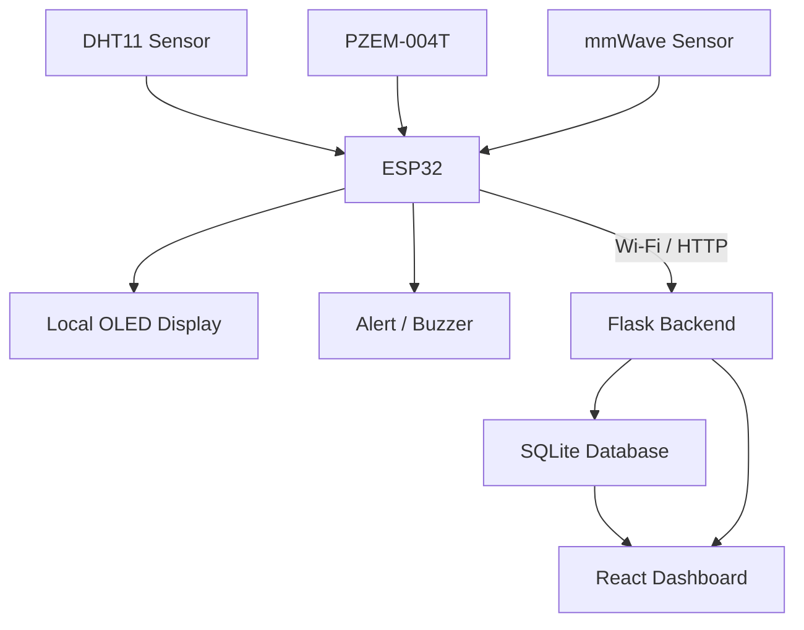

# Smart Lab Monitor 🏭

**An IoT-Based Smart Laboratory Monitoring System using ESP32, Flask, SQLite and React.**

[](https://www.espressif.com/)
[](https://platformio.org/)
[](https://flask.palletsprojects.com/)
[](https://www.sqlite.org/)
[](https://react.dev/)
[]()

## 📌 Overview

Smart Lab Monitor is an IoT-based laboratory monitoring system designed to monitor environmental conditions, electrical parameters and human presence in a laboratory environment.

The system uses an ESP32 microcontroller to collect sensor readings and transmit the data to a Flask-based backend through Wi-Fi. The backend processes the incoming data and stores it in an SQLite database. A React-based frontend provides a dashboard for visualizing monitoring information.

The project aims to improve laboratory safety, monitoring and resource awareness through real-time sensor data collection and centralized visualization.

## 🎯 Project Objectives

- Monitor laboratory temperature and humidity.
- Measure electrical parameters using the PZEM-004T module.
- Detect human presence using a mmWave sensor.
- Provide visual and audible alerts for selected conditions.
- Transmit sensor readings over Wi-Fi.
- Store sensor data for historical analysis.
- Display monitoring information through a web dashboard.

## ✨ Key Features

| Feature | Description |
|---|---|
| Environmental Monitoring | Temperature and humidity monitoring using DHT11 |
| Electrical Monitoring | Voltage, current, power, energy and frequency measurements using PZEM-004T |
| Human Presence Detection | mmWave-based presence detection |
| Alert System | Buzzer and temperature warning logic |
| OLED Display | Local sensor information using SSD1306 |
| Wi-Fi Communication | ESP32 communicates with the Flask backend |
| Data Storage | Sensor readings stored in SQLite |
| Web Dashboard | React-based monitoring interface |

## 🏗️ System Architecture

The project follows a modular IoT architecture.



### Data Flow

1. Sensors collect environmental, electrical and presence data.
2. ESP32 processes sensor readings.
3. The ESP32 sends data to the backend through HTTP POST requests.
4. Flask validates and stores incoming readings.
5. SQLite maintains the monitoring records.
6. The React frontend retrieves data through API endpoints and displays it.

## 🔧 Hardware Components

| Component | Purpose |
|---|---|
| ESP32-WROOM-32 | Main microcontroller |
| DHT11 | Temperature and humidity sensing |
| PZEM-004T | Electrical parameter monitoring |
| mmWave Sensor | Human presence detection |
| OLED SSD1306 | Local display |
| Buzzer | Audible alerts |
| LEDs | Visual status indication |
| Power Supply | System power |

*MQ-2 gas sensing is a planned extension and should be considered separately from the currently integrated firmware features.*

## 📍 ESP32 Pin Configuration

The current firmware configuration uses the following GPIO assignments:

| Component | ESP32 GPIO |
|---|---|
| DHT11 Data | GPIO 16 |
| OLED SDA | GPIO 21 |
| OLED SCL | GPIO 22 |
| mmWave Output | GPIO 34 |
| Buzzer | GPIO 25 |
| PZEM RX | GPIO 26 |
| PZEM TX | GPIO 27 |

OLED I2C address: `0x3C`

Serial communication baud rate: `115200`

**Hardware note:** Verify sensor voltage compatibility, UART connections and mains isolation before connecting or operating the PZEM module.

## 💻 Software and Technologies

### Firmware
- C++
- Arduino Framework
- PlatformIO
- ESP32
- Wi-Fi communication
- HTTP client

### Backend
- Python
- Flask
- REST API
- SQLite3

### Frontend
- React
- JavaScript
- CSS
- Vite

### Development Tools
- Visual Studio Code
- PlatformIO IDE
- Git and GitHub
- Arduino ecosystem

## 📂 Project Structure

```text
Smart-Lab-Monitor/
│
├── backend/
│   ├── app.py
│   └── requirements.txt
│
├── database/
│   └── database.py
│
├── docs/
│   ├── API.md
│   ├── ARCHITECTURE.md
│   ├── DATABASE.md
│   ├── DATA_FORMAT.md
│   ├── HARDWARE.md
│   ├── PRD.md
│   ├── ROADMAP.md
│   ├── SETUP.md
│   └── TEST_PLAN.md
│
├── firmware/
│   ├── include/
│   ├── lib/
│   ├── src/
│   ├── test/
│   └── platformio.ini
│
├── frontend/
│   ├── public/
│   ├── src/
│   ├── package.json
│   └── vite.config.js
│
├── .gitignore
└── README.md
```

## ⚙️ Installation and Setup

### Prerequisites

Install the following software:

- Python 3.x
- Node.js and npm
- Visual Studio Code
- PlatformIO extension
- Git
- ESP32 development board

### 1. Clone the Repository

```bash
git clone https://github.com/Nagrishi/Smart--Lab-monitor.git

cd Smart--Lab-monitor
```

### 2. Configure ESP32 Firmware

Open the firmware folder in VS Code with PlatformIO installed.

Create your private configuration file:

`firmware/include/config_secrets.h`

Add your Wi-Fi credentials:

```cpp
#pragma once

#define WIFI_SSID "YOUR_WIFI_NAME"
#define WIFI_PASSWORD "YOUR_WIFI_PASSWORD"
```

The actual credentials file must remain private and must never be committed to GitHub.

Build the firmware:

```bash
cd firmware
pio run
```

Connect your ESP32 and upload:

```bash
pio run --target upload
```

### 3. Set Up the Python Backend

Open a terminal in the project root:

```bash
cd backend
```

Create a virtual environment:

```bash
python -m venv .venv
```

Activate it on Windows:

```powershell
.venv\Scripts\Activate.ps1
```

Install dependencies:

```bash
pip install -r requirements.txt
```

Start the Flask application:

```bash
python app.py
```

The backend will run at:

```text
http://127.0.0.1:5000
```

### 4. Initialize the Database

If database initialization is not performed automatically by the backend, run:

```bash
cd database
python database.py
```

This creates the SQLite database and required sensor-data table.

### 5. Start the React Frontend

Open another terminal:

```bash
cd frontend
```

Install dependencies:

```bash
npm install
```

Start the development server:

```bash
npm run dev
```

Open the local URL printed by Vite in your browser.

**Note:** Configure the frontend API base URL to point to your Flask backend. For a separate frontend and backend development server, ensure the Flask CORS configuration permits the frontend origin.

## 🔌 Backend API

The Flask backend currently provides the following endpoints:

| Method | Endpoint | Purpose |
|---|---|---|
| GET | `/` | Backend welcome message |
| GET | `/api/health` | Check backend and database health |
| POST | `/api/sensor` | Receive sensor readings |
| GET | `/api/sensor` | Retrieve stored sensor records |
| GET | `/api/sensor/latest` | Retrieve the latest sensor reading |

### Example Sensor Data

The firmware can send sensor information using an HTTP POST request.

Example JSON payload:

```json
{
  "temperature": 28.5,
  "humidity": 65.0,
  "voltage": 230.0,
  "current": 1.2,
  "power": 276.0,
  "energy": 1.5,
  "frequency": 50.0,
  "power_factor": 0.95,
  "mmwave_person_detected": 1,
  "temperature_warning": 0,
  "buzzer_on": 0
}
```

The backend also supports optional sensor fields for gas monitoring.

## 🗄️ Database Design

The project uses SQLite for local data storage.

The `sensor_data` table contains:

- ID
- Temperature
- Humidity
- Timestamp
- Voltage
- Current
- Power
- Energy
- Frequency
- Power factor
- MQ-2 sensor readings
- mmWave presence status
- Gas alert status
- Temperature warning status
- Buzzer status

The database schema is extended through a migration mechanism that adds missing columns without recreating the existing table.

**Security:** The actual SQLite database is excluded from GitHub using `.gitignore`. Only the database creation script is included in the repository.

## 🔐 Security Considerations

- Wi-Fi credentials are stored in a private firmware configuration file.
- Environment variables and private keys should never be committed.
- SQLite database files and local backups are excluded from Git tracking.
- API authentication and production HTTPS should be implemented before exposing the system publicly.
- Never expose private credentials in frontend code.

## 🚀 Future Improvements

The following improvements are planned:

- [ ] MQ-2 gas sensor integration in ESP32 firmware
- [ ] Real-time dashboard updates
- [ ] Historical sensor data visualization
- [ ] Cloud database integration using PostgreSQL
- [ ] Secure device authentication
- [ ] HTTPS communication
- [ ] User authentication and role-based access
- [ ] Automated alert notifications
- [ ] Advanced data analytics
- [ ] Deployment to a cloud hosting platform

## 🧪 Testing

The project includes separate firmware, backend and hardware testing documentation.

Refer to:

- `docs/TEST_PLAN.md`
- `docs/HARDWARE.md`
- `docs/SETUP.md`

Hardware readings and system behavior should be validated on the actual connected devices before production use.

## 🤝 Contribution

Contributions, suggestions and improvements are welcome.

1. Fork the repository.
2. Create a feature branch.
3. Implement your changes.
4. Test your changes.
5. Submit a pull request.

Please do not include passwords, API tokens or private database files in contributions.

## 👨‍💻 Project Information

**Project:** Smart Lab Monitor

**GitHub:** [Nagrishi](https://github.com/Nagrishi)

**Repository:** [Smart Lab Monitor](https://github.com/Nagrishi/Smart--Lab-monitor)

**Domain:** Electronics and Communication Engineering | Embedded Systems | IoT

**Development Status:** Under Development

---

⭐ If you find this project interesting, consider giving the repository a star!

*Built as an engineering project exploring embedded systems, IoT communication, sensor integration and full-stack development.*